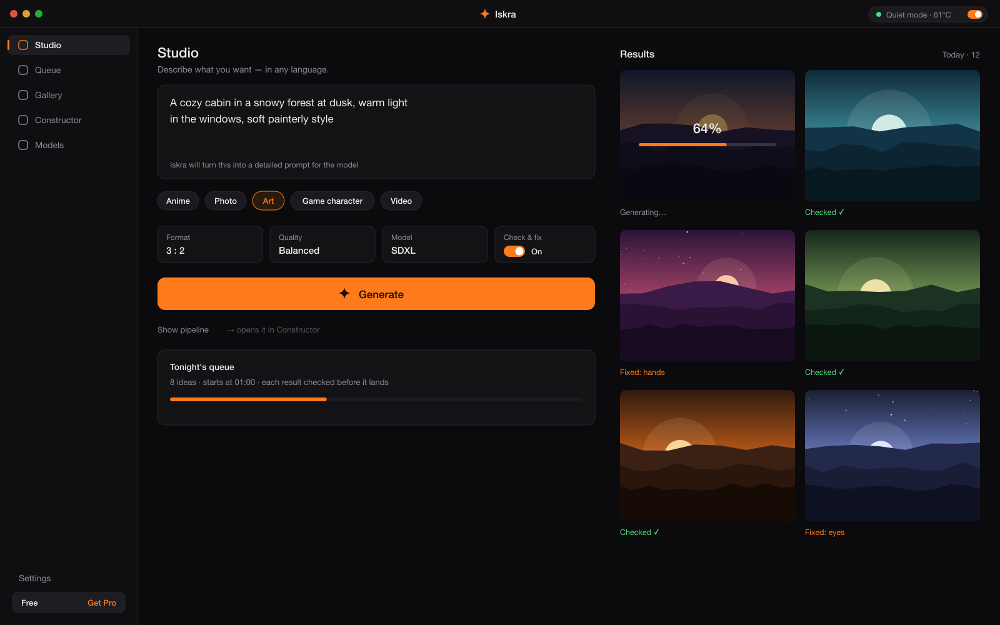

  

<h1 align="center">Iskra</h1>

  <b>Describe it in your own words — get an image or a video. On your computer. No subscriptions.</b> 
  <a href="https://krinsh.github.io/iskra/">Website</a> ·
  <a href="https://github.com/KRINSH/iskra/releases/latest">Download</a> ·
  <a href="https://olegster05.gumroad.com/l/iskra">Iskra Pro</a> ·
  <a href="https://krinsh.github.io/iskra/uk/">Українською</a> ·
  <a href="https://krinsh.github.io/iskra/ru/">По-русски</a>

  

Iskra is a desktop app for generating images and video with open AI models **locally** — on a Mac with Apple Silicon or a Windows PC with an NVIDIA GPU. No cloud, no account, no per-image fees.

## What makes it different

- **Studio, not wires.** Type what you want in any language (English, Ukrainian, Russian…). A local language model turns it into a proper prompt. Pick a preset — Anime, Photo, Art, Game character, Video — and press Create.
- **Checks its own work.** A local vision model reviews anatomy and how well the result matches your idea, and redoes the flawed ones automatically. *(Pro)*
- **Night queue.** Leave a list of ideas, wake up to a folder of finished, checked work. *(Pro)*
- **Quiet mode for laptops.** Iskra keeps an eye on temperature and slows down before the fans get loud.
- **Video from an image** with Wan 2.2, **game sprite sheets** with transparent background and a JSON atlas, **the same character in new scenes**. *(Pro)*
- **Node Constructor** for when you want full control — every Studio result can be opened as a pipeline.

## Free and Pro

| | Free | Pro — $19 once (launch price $12) |
|---|---|---|
| Studio and Constructor for images | ✓ | ✓ |
| All image models, quiet mode, gallery, compression | ✓ | ✓ |
| Video from images | | ✓ |
| Check & fix defects automatically | | ✓ |
| Night queue and batches | | ✓ |
| Game assets, same character, upscale 2K/4K, face & hands detailer | | ✓ |

Pro is a one-time purchase with a license key (free 1.x updates, 14-day refund if Iskra doesn't run on your computer): **[get Iskra Pro](https://olegster05.gumroad.com/l/iskra)**. Paste the key in Iskra → Settings → Pro.

## Download and install

Get the latest version from **[Releases](https://github.com/KRINSH/iskra/releases/latest)**.

- **macOS (Apple Silicon, macOS 12+):** open the `.dmg` and drag Iskra to Applications. The app isn't notarized by Apple yet, so the first launch is blocked: open **System Settings → Privacy & Security**, scroll down and click **Open Anyway** next to Iskra. You only do this once.
- **Windows 10/11 (NVIDIA):** run the `-setup.exe`. If SmartScreen says "Windows protected your PC", click **More info → Run anyway** (the installer isn't code-signed yet).

On first launch Iskra installs its engine (about 4–5 GB, once) and offers a starter model (Stable Diffusion XL base, 6.9 GB, commercial use of results allowed). Models and results live in `~/Iskra/`.

**Recommended:** Mac with 16 GB+ unified memory, or an NVIDIA GPU with 8 GB+ VRAM; ~15 GB free disk.

## Models and licenses

Iskra doesn't ship models — you download them from Hugging Face inside the app, and each model shows its license and whether commercial use of results is allowed. Wan 2.2 is Apache 2.0; SDXL base is CreativeML Open RAIL++-M; some community models have their own terms.

## Support

Questions, bugs, ideas: [open an issue](https://github.com/KRINSH/iskra/issues).

---

© 2026 Iskra. The app is free to use; Pro features require a license. This repository hosts the website and release builds.
